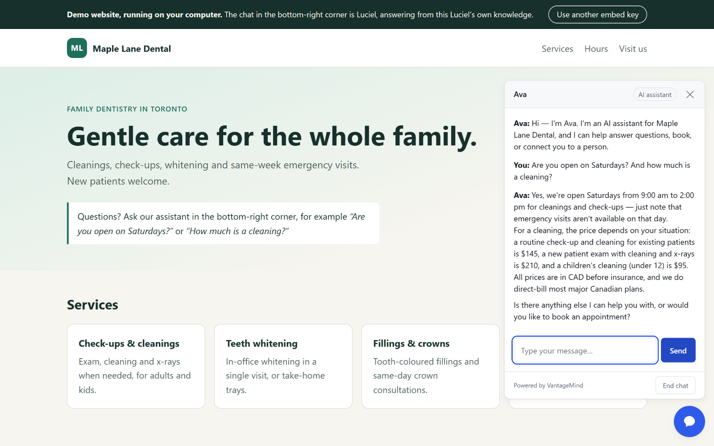
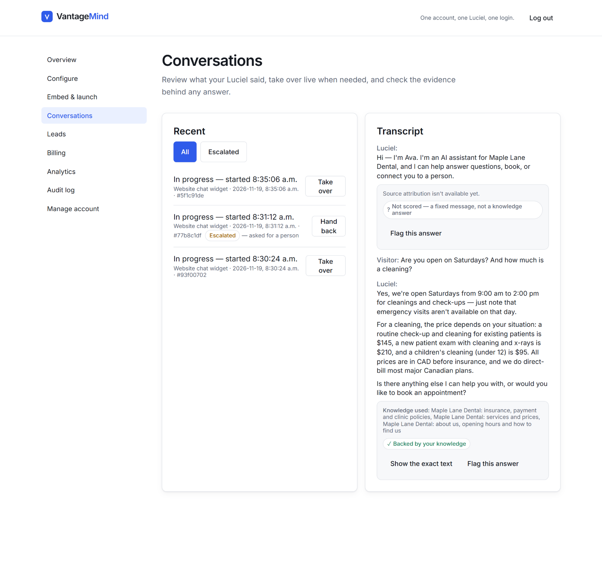
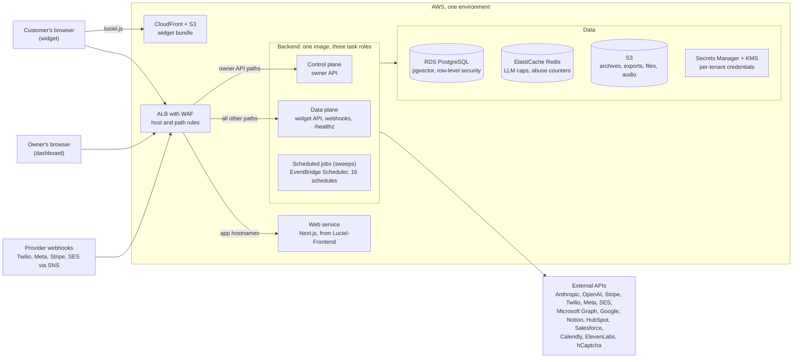

# Luciel — Backend

Luciel, by VantageMind, is an AI front-desk employee for small businesses. It answers a
business's customers on its website and on the business's own email, SMS, voice, WhatsApp,
Messenger and Instagram accounts, using that business's own knowledge. When it cannot answer
confidently it hands the conversation to the team instead of guessing, and the owner runs it
from a dashboard.

This repository is the backend: the FastAPI service behind the dashboard and the website widget,
the channel webhooks, knowledge ingestion and retrieval, the grounded answer loop, billing,
scheduled jobs, and the AWS CDK infrastructure for the whole product. The dashboard, marketing
site and widget live in the companion
[Luciel-Frontend](https://github.com/aryanonline/Luciel-Frontend) repository.

Luciel is open source under the [GNU AGPL-3.0](LICENSE).



## Run Luciel on your computer

The whole product runs locally with Docker: the dashboard, this backend with real AI answers,
the chat widget on a demo website, a sample business with its documents, and an email inbox that
catches every email Luciel sends. Nothing talks to AWS, Stripe, Twilio or Meta.

You need [Docker Desktop](https://www.docker.com/products/docker-desktop/) (or Docker Engine
with Compose v2), about 8 GB of free memory, and an
[OpenAI](https://platform.openai.com/api-keys) or
[Anthropic](https://console.anthropic.com/settings/keys) API key. An OpenAI key also powers the
knowledge search; with only an Anthropic key, Luciel searches with built-in keyword vectors.

```bash
git clone https://github.com/aryanonline/Luciel-Backend
git clone https://github.com/aryanonline/Luciel-Frontend
cd Luciel-Backend
cp .env.example .env          # Windows: copy .env.example .env
# open .env and set OPENAI_API_KEY and/or ANTHROPIC_API_KEY
docker compose up
```

Keep the two folders side by side: the stack builds the dashboard and the widget from
`../Luciel-Frontend`. The first run builds the images, which takes about ten minutes. The stack is
ready when the log prints `Luciel is ready`.

| Open                         | What it is                                                                |
| ---------------------------- | ------------------------------------------------------------------------- |
| `http://localhost:3000`      | The dashboard. Sign in as `demo@example.com` with the password `luciel-demo` |
| `http://localhost:8080`      | A demo website for Maple Lane Dental, a fictional clinic, with the chat   |
| `http://localhost:8025`      | The email inbox: verification, password-reset and hand-off emails         |
| `http://localhost:8000/docs` | The API reference                                                         |

Type `localhost` in the address bar, not `127.0.0.1`: the session cookie and the widget expect it.

### A five-minute tour

1. Sign in to the dashboard. The overview shows the clinic's Luciel, and Configure lists the
   three documents it answers from.
2. Open **Embed & launch** and click **Try it on the demo website**. Ask the chat "Are you open on
   Saturdays?" or "How much is teeth whitening?": the answer comes from the clinic's documents.
3. Ask something they do not cover, such as "Can I bring my dog to my appointment?", or say "I'd
   like to speak to a person". Luciel tells the visitor the team will follow up instead of
   guessing, and the hand-off email arrives in the inbox at `http://localhost:8025`.
4. In the dashboard, **Conversations** shows the transcript with each answer's grounding score and
   sources. Take over a conversation and reply as a person; the widget shows the reply on its next
   poll.

   

5. Sign up your own account at `http://localhost:3000/signup` (the verification email lands in the
   local inbox), create your Luciel, add your documents or a website to crawl, and try it on the
   demo website with your own embed key.

### What works locally, and what needs real accounts

| Works locally                                                 | Needs real accounts or a public URL                         |
| ------------------------------------------------------------- | ----------------------------------------------------------- |
| Sign-up, email verification and password reset (local inbox)  | Replies from your own mailbox (Microsoft 365)               |
| Knowledge from pasted text, uploaded files, CSV and web crawls | Google Drive, Notion, HubSpot and Salesforce sync (OAuth)   |
| The website chat widget, hand-offs and human takeover         | SMS, voice, WhatsApp, Messenger and Instagram (Twilio, Meta) |
| Conversations, grounding scores, leads, analytics, audit log  | Card checkout and invoices (Stripe; billing runs simulated) |
| Session summaries and the morning brief email                 | Downloading a data export (it needs S3)                     |

A connection that needs a real provider says so instead of pretending to connect.

### Stop, reset and update

```bash
docker compose down          # stop; your data stays
docker compose down -v       # stop and delete all local data (the demo account comes back on the next start)
git pull && docker compose up --build    # update to the latest code
```

- **"Luciel needs an AI key"**: the `migrate` step stops the stack when `.env` has no key. Add one
  and run `docker compose up` again.
- **A port is already in use**: move Postgres or Redis with `LUCIEL_DB_PORT` or
  `LUCIEL_REDIS_PORT` in `.env`; the dashboard (3000), API (8000), demo website (8080) and inbox
  (8025) keep their ports.
- **Every answer is handed to the team**: read `docker compose logs api` for a provider error such
  as an invalid key or an exhausted quota.
- **`path ... Luciel-Frontend not found`**: clone Luciel-Frontend beside this repository, or set
  `LUCIEL_FRONTEND_SOURCE` in `.env` to where it is. Frontend changes you make there are built by
  `docker compose up --build`.

How it works: the stack runs this repository's production image with
`LUCIEL_INTEGRATION_MODE=mock`, so every delivery seam stays a local stand-in and no AWS service
is used, and `LUCIEL_LLM_POSTURE=live`, a development-only switch that binds the real LLM and
embeddings to the keys in `.env`. Platform email goes to [Mailpit](https://mailpit.axllent.org/)
over SMTP. A scheduler container runs the sweeps a local install needs (closing and summarising
idle conversations, retrying hand-off emails, re-syncing crawled sites, the morning brief).
Everything is in [`docker-compose.yml`](docker-compose.yml) and [`scripts/local/`](scripts/local).

## Highlights

- **Tenant isolation in PostgreSQL.** Every tenant table gets forced row-level security and a
  tenant policy, generated from the ORM metadata so no table is missed (`app/db/rls.py`). The app
  role is neither superuser nor `BYPASSRLS`, and the isolation suite (`tests/isolation/`), a
  separate CI step, checks that every tenant table has forced RLS and a tenant policy, and that
  one tenant cannot see or change another tenant's rows.
- **Grounding gate.** Each answer stores a grounding score: the share of its content words found
  in the retrieved knowledge (`app/runtime/grounding.py`). Unless a tool result backs it, a draft
  below 0.50 grounding or 0.6 self-reported confidence, either one alone, becomes a hand-off to
  the team (`app/runtime/escalation.py`, pinned by `tests/unit/test_grounding_floor.py`).
- **Two planes from one image.** One container image runs as two ECS services: the control plane
  (owner API, cookie sessions, credentialed CORS) and the data plane (widget, webhooks and
  `/healthz`; no cookies, a narrower IAM role). ALB path rules split them, and tests on both
  sides pin the same prefix list (`tests/unit/test_plane_routing.py`,
  `infra/test/plane-routing.test.ts`).
- **Sends fail closed.** In live mode an unconfigured sender returns no message ID, so nothing can
  report a send that did not happen, and `/healthz` lists every integration still running on a
  stand-in (`tests/unit/test_delivery_honesty.py`). Provider webhooks are verified before any
  runtime work (`app/channels/signatures.py`: Twilio by request signature or a secret token in the
  tenant's webhook URL), and a replayed Stripe event is ignored (`app/billing/webhooks.py`).
- **Knowledge sync as a job.** A manual sync that is not done within 20 seconds returns 202 and
  keeps running. Liveness is a PostgreSQL advisory lock keyed on the source, not a timestamp, so
  two syncs of one source never overlap and a killed job reads as interrupted
  (`app/knowledge/sync_job.py`).
- **Append-only audit log.** A post-migration superuser step moves the audit tables' ownership to
  a role the app cannot assume and adds row and `TRUNCATE` guards (`scripts/lock_audit_log.sql`).
  CI applies it, and every migration task and a post-deploy probe verify it.
- **Image CVE gate with expiring waivers.** Both platform images of the multi-arch build are
  gated on their ECR scans (`scripts/check_image_scan.py`): a CRITICAL or HIGH finding fails
  unless `.security/cve-allowlist.json` waives it with a reason and an expiry date, and an
  expired waiver or an incomplete scan fails too.
- **Deploys gated on live behavior.** A dev deploy is not done until a smoke probe, an in-VPC
  database probe and, in live mode, SeedTest (`scripts/seed_and_livetest.py`), a strict harness
  that drives a throwaway tenant through the real API, have passed; if one fails, the services
  roll back (a production release runs SeedTest on preprod before deploying).

## Architecture



Each environment is one VPC in `ca-central-1`: the CDK app pins every stack to that region and
the data buckets deny requests from any other region; only the CloudFront certificate lives in
`us-east-1`. Backend tasks run on Graviton (arm64) in private subnets, with RDS and Redis in
isolated subnets, and scheduled work runs as one-off ECS tasks from the same image. No secrets
are committed: tenant credentials live in Secrets Manager under a `vm/` prefix and the database
stores only pointers.

A customer message goes through four steps:

1. **Ingress:** the widget's embed key and site origin allowlist, or the provider webhook's
   verification, are checked first; every query then runs under that tenant's RLS policy.
2. **Answer:** session, input safety checks, retrieval (vector search, plus graph facts for
   structured questions) and a draft from Anthropic, failing over to OpenAI.
3. **Gate and delivery:** the grounding gate turns a weak draft into a recorded hand-off, and the
   reply leaves through the channel's own provider, as the business, failing closed.
4. **Afterwards:** sessions close and are summarized, billable conversations are reported to
   Stripe as deltas, and audit events are appended.

## Tech stack

| Area | Technology |
| --- | --- |
| API | Python 3.12, FastAPI, Uvicorn, Pydantic v2 |
| Data | PostgreSQL with pgvector (RDS PostgreSQL 16 in AWS, PostgreSQL 17 locally and in CI), SQLAlchemy 2 async on asyncpg, Alembic (77 migrations), Redis |
| AI | Anthropic Claude (primary) with OpenAI fallback; OpenAI embeddings; default model IDs pinned in `app/config.py`, with a daily check that swaps a retired chat model for its successor |
| Channels | Website widget; the business's own Outlook mailbox (Microsoft Graph) and Twilio account (SMS, voice); WhatsApp and Messenger through one Meta connection; Instagram |
| Knowledge and tools | File upload (PDF, DOCX, CSV, text), Google Drive, Notion, website crawl, HubSpot, Salesforce; Google Calendar and Calendly booking |
| Billing | Stripe Billing Meters, pay-as-you-go |
| Infrastructure | AWS CDK v2 in TypeScript: ECS Fargate on Graviton, ALB, WAF, RDS, ElastiCache, S3, CloudFront, Secrets Manager with KMS, EventBridge Scheduler, CloudWatch, SNS, SES, AWS Budgets |
| Tooling | uv, ruff, mypy, bandit, pip-audit, detect-secrets, pytest, Jest |

## Repository layout

| Path | Contents |
| --- | --- |
| `app/main.py`, `app/config.py` | App factory (plane-aware CORS, trace IDs, `/healthz`, routers); settings and default model pins |
| `app/api/` | Versioned routes (`v1/admin`, auth, widget, billing, webhooks), auth dependencies, paging, error contract |
| `app/runtime/` | The conversation loop (`orchestrator.py`): sessions, input safety, retrieval, grounding, escalation and hand-off, LLM router and providers, voice |
| `app/knowledge/` | File parsing, provider sync and sync jobs, chunking, embeddings, knowledge graph |
| `app/channels/`, `app/connections/` | Channel ingress, signature checks and outbound delivery; customer-owned provider connections (OAuth, verification, health, secrets) |
| `app/tools/`, `app/billing/` | Tool catalog, authorization, broker and calendar backends; conversation metering, Stripe gateway and webhooks, dunning, notices |
| `app/lifecycle/`, `app/jobs/` | Pause, delete with a 30-day restore window, close and reopen, exports, retention, transcript archive; the sweep entrypoint (`python -m app.jobs <sweep>`) |
| `app/auth/`, `app/notifications/`, `app/employee/` | Accounts and sessions; owner notifications and escalation dispatch; status and the morning brief |
| `app/analytics/`, `app/audit/`, `app/policy/`, `app/observability/` | Owner analytics, append-only audit log, entitlements, structured logs and metrics |
| `app/models/`, `app/schemas_api/`, `app/db/`, `app/migrations/` | ORM models, wire schemas, engine, sessions and RLS helpers, Alembic history |
| `infra/` | CDK app: `bin/` entrypoint, `lib/` stacks, `test/` Jest assertions |
| `scripts/` | Database bootstrap and audit lock, ECS task runners, CVE gate, smoke probe, rollback, SeedTest harness; `scripts/local/` runs the local Docker stack (migrate, scheduler, demo seed, smoke check) |
| `tests/` | `unit/`, `integration/`, `contract/` (frontend wire contracts) and `isolation/` suites |
| `.github/workflows/`, `.security/` | CI, deploy and maintenance workflows; dated, expiring waivers for the image CVE gate |
| `Dockerfile`, `docker-compose.yml`, `pyproject.toml`, `uv.lock` | Multi-stage, non-root image; the local stack (the whole product, or only PostgreSQL and Redis for the tests); dependencies, tool configuration and the lock that CI tests and the image installs |

## Local development

To try the product, use the Docker stack in
[Run Luciel on your computer](#run-luciel-on-your-computer). To work on the backend itself, run
it from a virtual environment against the stack's database and Redis.

Requirements: Python 3.12, [uv](https://docs.astral.sh/uv/) (CI and the image pin 0.12.23),
Docker, and a `psql` client for the test suite. The CDK app in `infra/` uses Node.js 20, as the
deploy workflow does.

```bash
docker compose up -d db redis        # PostgreSQL 17 + pgvector 0.8.0 and Redis 7; first start creates roles and database
uv sync --frozen --extra dev --python 3.12
source .venv/bin/activate            # Windows: .venv\Scripts\activate
cp .env.example .env                 # mock mode against the local database
```

Prepare the database with the steps `scripts/migrate.sh` runs in AWS, then start the API:

```bash
SUPER="host=127.0.0.1 port=5432 dbname=luciel_dev user=postgres password=postgres"
python scripts/run_sql.py --dsn "$SUPER" --file scripts/bootstrap_roles.sql   # roles and grants
alembic upgrade head                                                          # schema, RLS, grants, as luciel_app
python scripts/run_sql.py --dsn "$SUPER" --file scripts/lock_audit_log.sql    # append-only audit log
uvicorn app.main:app --reload --port 8000
```

`LUCIEL_INTEGRATION_MODE=mock` (the default) uses a deterministic model and fake senders with no
external keys; `live` calls real providers and has to be chosen on purpose. For real AI answers
under mock mode on your own computer, set `LUCIEL_LLM_POSTURE=live` and put your key in
`LUCIEL_PLATFORM_SECRET`, a JSON object with `OPENAI_API_KEY` and/or `ANTHROPIC_API_KEY`; `LUCIEL_SMTP_HOST`
sends platform email to a local inbox such as the stack's Mailpit (`localhost`, port 1025 from
the host after publishing it). Both switches refuse to start outside `development`. With the default
`LUCIEL_ENVIRONMENT=development` the OpenAPI docs are at `http://localhost:8000/docs`; deployed
environments return 404 there. To run the Luciel-Frontend dashboard against this backend, set
`LUCIEL_COOKIE_SECURE=false` here and start the frontend with `NEXT_PUBLIC_API_ADAPTER=http` and
`NEXT_PUBLIC_API_BASE_URL=http://localhost:8000`.

## Tests and quality checks

The suites need PostgreSQL with pgvector (the compose database works) and `psql` on the `PATH`.
The test session creates its own `luciel_test` database as the superuser, migrates it and
applies the audit lock; the isolation suite and most integration and contract tests also assert,
before each test, that the app role is neither superuser nor `BYPASSRLS`.

```bash
export LUCIEL_SUPERUSER_TCP=1 PGPASSWORD=postgres LUCIEL_INTEGRATION_MODE=mock
python -m pytest tests/isolation                               # tenant-isolation suite
python -m pytest tests/unit tests/integration tests/contract   # everything else
ruff check app tests scripts && ruff format --check app tests scripts && mypy app
```

The suites hold 8 isolation tests and more than 4,000 unit, integration and contract tests, and CI
(`.github/workflows/ci.yml`) runs all of them on every pull request, every push to `main`, daily
and on demand. The daily run makes a newly published CVE fail the build without a push, and a
failed daily run is posted to the month's dependency-review issue.

| CI step | What it enforces |
| --- | --- |
| Locked install | `uv lock --check`, then `uv sync --frozen`: CI tests exactly the dependency set the image installs |
| Lint and types | `ruff check` and `ruff format --check` over `app/`, `tests/` and `scripts/`; `mypy` in strict mode over `app/` |
| Security | `bandit`; `pip-audit --strict`, which fails on any vulnerability that has a fix; `detect-secrets-hook`, which fails on any secret in a tracked file that `.secrets.baseline` does not list |
| Migrations | `alembic upgrade head`, `downgrade base`, `upgrade head`, then the audit-log lock as superuser |
| Tests | The tenant-isolation suite as its own step, then the unit, integration and contract suites |
| Infrastructure | A separate `infra` job: `npm ci`, `tsc --noEmit` and the CDK Jest assertions |

To run the CDK Jest assertions (`infra/test/`, 29 files) locally: `cd infra && npm ci && npm test`.

## Deployment

Deploys run only by manual dispatch of `.github/workflows/deploy.yml` from `main`. There is no
push trigger, a guard job refuses any other ref before the first AWS call, and the workflow
reaches AWS through GitHub OIDC roles, with no stored keys. It reads the AWS account id from the
`AWS_ACCOUNT_ID` repository variable and the operator inbox from the `BUDGET_ALERT_EMAIL` secret.

Dev is paused (see [Project status](#project-status)), so it comes back through the runbook in
[`docs/operations/teardown-and-restore.md`](docs/operations/teardown-and-restore.md), not through
a single deploy. On a running environment, a deploy is one command:

```bash
gh workflow run deploy.yml --ref main -f environment=dev -f integration_mode=live
```

A dev deploy runs these steps in order:

1. Build the multi-arch image, push it to an immutable ECR repository under the commit SHA, and
   run the CVE gate on each platform's scan.
2. Record the task definitions currently serving, as the rollback target.
3. Migrate with the new image as a one-off ECS task inside the VPC, before any service rolls.
   Migrations are expand-first, so the old code keeps working on the new schema during the roll.
4. `cdk deploy` the stacks with ECS on the scanned image, then reconcile the services and sweep
   schedules onto the revisions the stack deployed.
5. Smoke probe (`scripts/smoke_probe.sh`): `/healthz` in the requested mode with no unexpected
   degraded binding, both planes reachable, HTTP redirected to HTTPS, `/docs` and `/openapi.json`
   returning 404.
6. Database probe as the app role (`scripts/verify_probe.sql`): the audit log rejects updates;
   both audit tables reject truncation and are not owned by the app role, which is not a
   superuser or a member of the audit-owner role; and the connections table has no
   raw-credential columns.
7. In live mode, the strict SeedTest gate (`scripts/run-seedtest-task.sh dev --strict`), where an
   unexpected skip counts as a failure.

If the deploy or a later gate fails, `scripts/rollback_services.py` points the services and sweep
schedules back at the previous task definitions; the schema stays where the migration left it.
`-f paused=true` scales every service to zero and disables the schedules (`false` resumes). It
leaves the database, Redis, the NAT gateway and the load balancer in place, so it still costs
money; the 2026-11-14 pause deleted most of the environment instead. A production release adds
approval on the protected `prod` environment and a temporary production-shaped `preprod`, built
from the same gated image, that must pass the database probe and the SeedTest harness before
production deploys; `preprod` is always destroyed afterwards.

## Operations

The scheduled jobs and alarms below belong to a deployed environment; while dev is paused, neither
runs.

**Scheduled jobs.** Sixteen sweeps (`app/jobs/sweeps.py`) run from EventBridge Scheduler
(`infra/lib/compute-stack.ts`). Every sweep except the platform-level model-ID check works one
tenant per transaction under a per-sweep, per-tenant advisory lock, so overlapping runs do not
duplicate work. A schedule whose task launch call fails is retried up to three times within an
hour, and because sweeps are idempotent, the next scheduled run picks up what a failed run missed.

| Cadence | Sweeps |
| --- | --- |
| Hourly | Deferred-action retries, session close and summary, the owner's morning brief (due at 07:00 local), and a backstop for the data plane's five-minute mailbox poll |
| Every 6 hours | Connection health checks; knowledge re-sync (websites are re-crawled once a day) |
| Daily | Transcript archive to S3 at 90 days, one-year retention, delete-grace expiry, closed-account purge, dunning, Stripe usage reconciliation, unverified-account purge, billing and legal notice emails, LLM model-ID check |
| Weekly | Audit-log retention |

**Alarms.** CloudWatch alarms email the operator through SNS: ALB 5xx and p95 latency, repeated
LLM fallback, both LLM providers failing, degraded knowledge retrieval, an escalation backlog,
sweep errors and per-tenant sweep failures, and conversation caps hit at volume. EventBridge rules
report sweep tasks that exit non-zero or fail to start, CDK synthesis fails if no operator email
is given, and AWS Budgets alerts at 80% and 100% of each environment's monthly
ceiling and on a forecast breach.

**Repository automation.**

| Workflow | When | What it does |
| --- | --- | --- |
| `image-rebuild.yml` | Weekly; disabled while dev is paused | Rebuilds the image from `main`, runs the CVE gate in report mode and posts the findings; never deploys |
| `dependency-review.yml` | Monthly; disabled while dev is paused | Opens the month's dependency and CVE review issue: outdated packages, lock drift, waivers and their expiry, the latest scan |
| `dependabot-auto-merge.yml` | After CI on a Dependabot PR | Merges a green minor or patch update and labels a major one for a person |
| `dev-cost-guard.yml` | Daily; disabled while dev is paused | Keeps the database of an environment deployed with `paused=true` stopped, since AWS restarts a stopped RDS instance after seven days |

The three disabled workflows need the AWS environment; the restore runbook turns them back on.

## Project status

The backend ran in a development environment in `ca-central-1` and was verified live until
2026-11-14. The last build was deployed from `main` that day and passed every gate above in live
mode, including the strict SeedTest gate. A day earlier that gate had stopped a deploy and rolled
the services back automatically: the model worded its AI disclosure freely, and on email those
words counted against grounding, so an honest answer was handed off. The system prompt now gives
the exact sentence and the grounding scorer removes only that platform-authored text. After the
deploy, a customer-style end-to-end walk of the deployed product, driven from the frontend
repository, passed again (it first passed on 2026-11-02, the day the SeedTest matrix of eight
configurations passed against the live backend).

Later that day the environment was paused to stop AWS charges. Most of it was deleted; the
database snapshot, an archive of its stored files, the platform secret and the deploy roles were
kept so that it can be restored. Until then nothing answers on its hostnames. What was kept, what
the pause costs and the restore runbook are in
[`docs/operations/teardown-and-restore.md`](docs/operations/teardown-and-restore.md).

Production has not been stood up yet: the release path exists in `deploy.yml` but has never run.
Dev used Stripe in test mode, so no real payments were taken.

Since 2026-11-19 the whole product also runs on one computer with `docker compose up` (see
[Run Luciel on your computer](#run-luciel-on-your-computer)), and the `quickstart` workflow
builds and checks that stack on every change to it and once a week.

## Further reading

- [`.env.example`](.env.example) covers the local settings; [`app/config.py`](app/config.py)
  defines every setting and its default.
- [`docs/operations/teardown-and-restore.md`](docs/operations/teardown-and-restore.md) records
  what the 2026-11-14 pause kept, deleted and disabled, and how to restore dev.
- [`CLAUDE.md`](CLAUDE.md) is the working guide to this codebase: product invariants, the
  architecture map, the test recipe and deploy rules; most modules carry their own. Tags in
  these guides, comments and test names, such as "round 7 WP-3c", "D6", "Arc 14", "F039" or
  "§3.1.6a", refer to internal work packages, owner decisions, audit ids and specification
  sections kept outside the repository.

## License

Copyright © 2026 VantageMind. Luciel is free software: you can redistribute it and modify it
under the terms of the [GNU Affero General Public License, version 3](LICENSE). If you run a
modified version as a network service, the licence requires you to offer its users the
corresponding source code.

Issues and questions are welcome; see [`CONTRIBUTING.md`](CONTRIBUTING.md). To report a
vulnerability, see [`SECURITY.md`](SECURITY.md).
